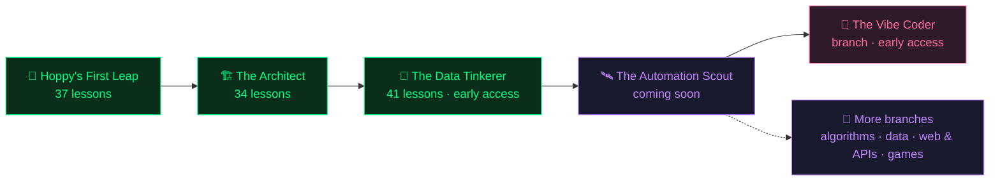

<p align="center">
  
</p>

<p align="center">
  <a href="https://www.hoppypy.com"></a>
  <a href="https://www.hoppypy.com/en/courses"></a>
  <a href="./README_zh.md"></a>
</p>

<p align="center">
  
  
  
  
  <a href="./cheatsheet.md"></a>
</p>

---

# 🐸 HoppyPy — Learn Python & AI the Hoppy Way

> **Forget installations. Forget boring lectures. Just open your browser and start coding.**

HoppyPy is a **100% free**, interactive Python course for **absolute beginners**. No sign-up and nothing to install: you write and run real Python right in your browser (powered by [Pyodide](https://pyodide.org)), one small lesson at a time, guided by Hoppy the frog.

> [!TIP]
> **🤖 NEW: [Vibe Coding Prompt Templates](./vibe-coding)** — A curated collection of copy-paste prompts for AI-Native IDEs. Build web apps, automate tasks, and create AI agents — all with natural language. _Inspired by Andrej Karpathy's Vibe Coding philosophy._

<br/>

## ✨ Why HoppyPy?

|     | Feature                                       | Description                                                       |
| --- | --------------------------------------------- | ----------------------------------------------------------------- |
| 🎮  | **Gamified Learning**                         | Progress through themed adventures, earn XP, level up your skills |
| 🌐  | **Browser-Based**                             | No installation. No environment setup. Just click and code        |
| 🤖  | **Work with AI**                              | A dedicated track on directing AI agents and checking their code  |
| 🆓  | **100% Free**                                 | No paywalls, no premium tiers, no ads                             |
| 🔓  | **No Account Needed**                         | No sign-up. Your progress is saved in your own browser            |
| 🌍  | **Bilingual**                                 | Every lesson is available in English and Chinese                  |
| ⚡  | **Interactive Sandbox**                       | Write, run, and experiment with real Python code instantly        |
| 📝  | **[Prompt Templates](./vibe-coding/prompts)** | Ready-to-use Vibe Coding prompts for AI-Native IDEs               |

<br/>

## 🗺️ Learning Path

Every HoppyPy course sits on one course tree. Start with the **Core Path** to build solid Python basics, then branch out into what interests you. Complete beginners simply start with the first course.



| Track | Course | What you'll learn | |
| --- | --- | --- | --- |
| Core Path | 🌱 **Hoppy's First Leap** · 37 lessons | print, variables, strings, conditions, loops, lists, dictionaries, your first functions, plus three small real-world labs | [Start →](https://www.hoppypy.com/en/learn/python-basics/01-hoppy-speaks) |
| Core Path | 🏗️ **The Architect** · 34 lessons | Functions in depth, errors and exceptions, modules, classes and objects, reading and writing files, and office-style projects | [Start →](https://www.hoppypy.com/en/learn/python-architect/00-the-workshop) |
| Core Path | 🧩 **The Data Tinkerer** · 41 lessons · early access | Text cleanup, tuples and sets, counting, comprehensions, JSON and CSV, and tidying messy real-world data | [Start →](https://www.hoppypy.com/en/learn/python-data-tinkerer/01-the-dusty-note) |
| Core Path | 🛰️ **The Automation Scout** | Command line, files and folders, environments, APIs, and debugging | 🔜 Coming soon |
| Branch | 🤖 **The Vibe Coder** · early access | Directing AI agents to build things for you, and checking what they write | [Start →](https://www.hoppypy.com/en/learn/python-vibe/01-choose-your-weapon) |
| Branches | 🌿 More on the way | The Algorithm Hunter, The Data Wizard, The API Builder, The Workflow Smith, The Playmaker | 🔜 Planned |

👉 See the full, always up-to-date map on the **[learning roadmap](https://www.hoppypy.com/en/courses)**.

<br/>

## 💻 Code Examples

Get a taste of what you'll learn. All examples are runnable — try them out!

### 🌱 Hello Hoppy (Hoppy's First Leap)

```python
# Your first Python script — meet Hoppy! 🐸
name = "Hoppy"
level = 1
skills = ["print()", "variables", "f-strings"]

print(f"🐸 Hi! I'm {name}, Level {level}")
print(f"🛡️ Skills: {', '.join(skills)}")

# Hoppy's ASCII art
print("""
    @..@
   (----)
  ( >__< )
  ^^ ~~ ^^
""")
```

### 🎒 Lists & Dictionaries (Hoppy's First Leap)

```python
# Build a quest system with lists and dicts 🗺️
quests = [
    {"name": "Print your first line", "reward": 100, "done": True},
    {"name": "Build a to-do list",    "reward": 500, "done": False},
]

completed = [q for q in quests if q["done"]]
total_xp = sum(q["reward"] for q in completed)
print(f"📈 Progress: {len(completed)}/{len(quests)} | 💰 XP: {total_xp}")
```

### 🧩 Tidying Messy Data (The Data Tinkerer)

```python
# Clean up a messy sign-up sheet 🧹
raw = """name,email
  Alice ,ALICE@example.com
bob,bob@Example.com
  Alice ,alice@example.com"""

rows = raw.splitlines()[1:]          # skip the header row
seen = set()
for row in rows:
    name, email = row.split(",")
    email = email.strip().lower()
    if email not in seen:            # drop duplicates
        seen.add(email)
        print(f"{name.strip().title()} <{email}>")
```

> 📂 More complete examples in the [`examples/`](./examples) directory

<br/>

## 🎮 Try the Adventure Game!

Want something fun? Hoppy has a **terminal RPG adventure** where you fight Bug monsters with Python knowledge!

```bash
python examples/hoppy_adventure.py
```

> 🐛 3 boss battles • 12 questions • hint system • score tracking

<br/>

## 📋 Python Cheatsheet

We also have a **bilingual Python cheatsheet** — perfect for quick reference!

➡️ [View the Cheatsheet](./cheatsheet.md)

<br/>

## 🚀 Quick Start

No installation needed! Just visit **[hoppypy.com](https://www.hoppypy.com)** and start learning.

Want to run the examples locally?

```bash
# Clone this repo
git clone https://github.com/gdgd8760/hoppypy-repo.git
cd hoppypy-repo

# Run an example
python examples/01_hello_hoppy.py

# Or play the adventure game!
python examples/hoppy_adventure.py
```

<br/>

## 🌟 Why Python?

<table>
<tr>
<td width="25%" align="center">
<h4>🤖 AI Superpowers</h4>
<p>Don't watch the AI revolution — lead it. Control LLMs and build smart assistants.</p>
</td>
<td width="25%" align="center">
<h4>⚡ Automate Everything</h4>
<p>Turn hours of Excel copy-pasting into a 3-second script.</p>
</td>
<td width="25%" align="center">
<h4>📊 Data Insights</h4>
<p>Transform messy spreadsheets into clear, stunning visualizations.</p>
</td>
<td width="25%" align="center">
<h4>🛠️ Create, Don't Consume</h4>
<p>Build tools, websites, and games that solve real problems.</p>
</td>
</tr>
</table>

<br/>

## 🐸 About HoppyPy

HoppyPy launched in December 2025 and is an independent, one-person project. Read **[About HoppyPy](https://www.hoppypy.com/en/about)** for the story behind it and answers to common questions, or leave a note on the **[feedback page](https://www.hoppypy.com/en/feedback)**.

**The Hoppy family**

- 📈 **[HoppyQuant](https://quant.hoppypy.com/en)** — learn quantitative research with AI, starting with understanding data.
- 💬 **[HoppyChat](https://chat.hoppypy.com/)** — learn English like following a drama series (Chinese only).

<br/>

## 🤝 Contributing

We welcome contributions! Whether it's fixing typos, adding examples, or suggesting new lessons.

See [CONTRIBUTING.md](./CONTRIBUTING.md) for details.

<br/>

## 📄 License

This project is licensed under the [MIT License](./LICENSE).

---

<p align="center">
  <b>Ready to start your Python journey?</b><br/>
  <a href="https://www.hoppypy.com">
    
  </a>
</p>

<p align="center">
  Made with 💚 by HoppyPy<br/>
  <sub>If you find this helpful, please ⭐ star this repo — it helps more people discover free Python education!</sub>
</p>
